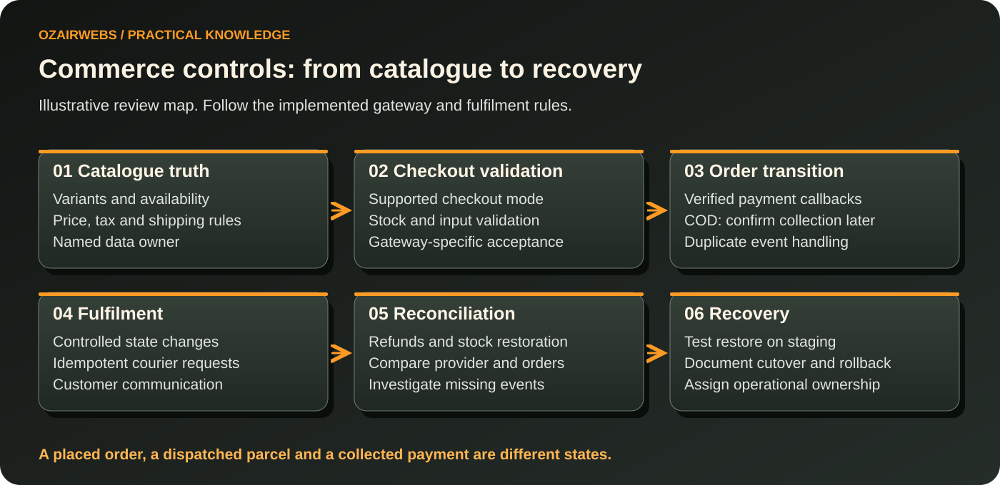
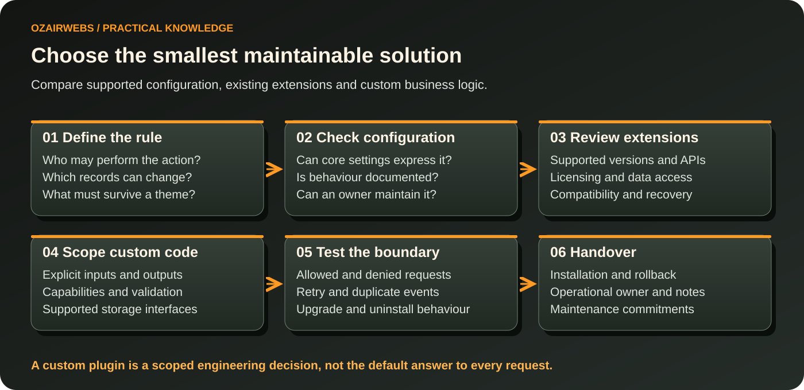

# WordPress and WooCommerce Engineering Resources by OzairWebs

*Conceptual service illustration. The technical maps below explain review decisions; they do not show client data or measured results.*

> **Engineering principle:** catalogue truth, payment evidence and recovery ownership belong in the scope before visual polish reaches checkout.

An editor-friendly website should remain understandable when its business grows. Problems usually appear at the boundaries: a plugin stores data in the wrong place, an import replaces approved content, a cache exposes personalised output, or a checkout extension fails after an update. This repository explains how to retain WordPress's publishing strengths while making custom functionality and commerce operations reviewable.

[OzairWebs WordPress and WooCommerce services](https://ozairwebs.com/services/wordpress-woocommerce/) describes the commercial scope. The resources here help owners, store managers and developers choose between configuration, a supported extension and custom engineering. They include a plugin-scoping checklist, WooCommerce compatibility checks, AI capability distinctions and practical maintenance guidance. No client plugin, paid extension source or private website backup is included.

Reviewed on **13 October 2026**. The official release sources identify **WordPress 7.1.3** and **WooCommerce 11.2.1** as current stable releases at review time. Features and compatibility must be checked against the installed site, PHP environment, theme and extensions. The [reference register](docs/references.md) separates stable core functionality, optional packages and emerging work; roadmap items are not described as delivered production features.

## Inspect the whole store journey

Read the top row before the operational follow-through in the lower row. Payment acceptance depends on the gateway and order type; cash-on-delivery needs a later collection state. [WooCommerce engineering](docs/woocommerce-engineering.md) expands the map into a practical compatibility checklist.

> **Release question:** can the team explain what happens when a payment callback repeats, a refund arrives, or a fulfilment request fails? A successful demo purchase is only one part of that answer.

## Find the guide for your operational problem

| Need | Resource |
| --- | --- |
| Model content and build an editor-friendly interface | [Custom WordPress development](docs/custom-wordpress-development.md) |
| Scope a private business plugin | [Custom plugin development](docs/custom-plugin-development.md) |
| Check store compatibility and order operations | [WooCommerce engineering](docs/woocommerce-engineering.md) |
| Understand AI Client, Abilities and MCP boundaries | [WordPress AI and automation](docs/wordpress-ai-automation.md) |
| Review permissions and data protection | [WordPress security](docs/wordpress-security.md) |
| Diagnose slow templates and database work | [Performance optimisation](docs/performance-optimization.md) |
| Maintain public search signals | [WordPress SEO](docs/wordpress-seo.md) |
| Plan updates, migration and recovery | [Maintenance and migration](docs/maintenance-and-migration.md) |
| Compare approaches before commissioning | [WordPress FAQ](docs/wordpress-faq.md) |

## Visual review: choose the right intervention

| Approach | A useful starting point | Evidence before committing |
| --- | --- | --- |
| Core configuration | Existing settings can express the rule | Document the setting, permissions and rollback |
| Supported extension | A maintained package covers the actual journey | Test installed versions, data access and checkout compatibility |
| Custom plugin | Durable business behaviour needs explicit engineering | Define inputs, permissions, supported storage and failure cases |
| Theme or block work | Editors need a reusable presentation pattern | Test accessible output and the real editing workflow |

The decision map compares options rather than prescribing a package. [Custom plugin guidance](docs/custom-plugin-development.md) explains the boundary and maintenance questions in more depth.

## Start with content ownership and business rules

WordPress suits organisations that need accessible publishing and a broad extension ecosystem. A consultancy may need reusable service templates and enquiry routes. A retailer may need a controlled catalogue with variant stock, tax and fulfilment rules. A publisher may need structured editorial review. Each case needs a content model and permission design that reflects actual work.

Separate editorial content from business logic. Custom post types, taxonomies and registered fields can make records easier to manage, while theme templates control presentation. Store durable business behaviour in a plugin when it should survive a theme change. Avoid turning every concept into a field: identify what editors actually need to search, filter, approve and reuse.

Multisite is useful when several sites share governance and infrastructure, but it also expands the consequences of changes across the network. Multilingual publishing needs translation ownership and a clear URL strategy. Both are architectural choices with maintenance costs, not default upgrades for any business that wants to grow.

## Modern themes, blocks and administration

Block themes and Full Site Editing provide ways to manage templates and styles through the editor. theme.json defines shared settings and design constraints. Gutenberg block development is appropriate when a repeated editorial unit needs structured inputs and predictable output. A custom block should have an editing experience that prevents common mistakes, rather than merely replacing a shortcode with an equally opaque interface.

The Interactivity API supports interactive behaviour integrated with WordPress blocks. Block Bindings connects supported block attributes to registered data sources. Check the supported attribute and source behaviour for the target release. Responsive layouts, focus states and readable validation remain implementation responsibilities. An accessible block cannot be inferred from the API used to build it.

WordPress 7.1 introduced additional responsive styling and editorial capabilities, including changes to media workflows and Notes. These can simplify selected authoring tasks, but an existing site's theme and plugin compatibility need verification before an upgrade. The [official release announcement](https://wordpress.org/news/2026/08/mary-lou/) provides the feature boundary. Do not assume every Gutenberg plugin feature is available in the installed core release.

Custom administrative screens and dashboards should reduce operational ambiguity. Give users clear statuses, limited actions and meaningful error recovery. The WordPress REST API can expose controlled data to applications and integrations; every sensitive endpoint needs an explicit permission check. Legacy modernisation should inventory custom fields, shortcodes, theme-specific logic and licensed dependencies before replacing templates.

## When custom plugin engineering is appropriate

Choose a supported existing plugin when its data model and update practices fit the requirement. Custom development is justified when a business rule is distinctive, an integration needs dependable reconciliation, or existing plugins require fragile overrides. Fewer plugins is not automatically safer or faster; one poorly designed custom plugin can create more risk than several well-maintained extensions.

A plugin brief should define the records, actors, permitted transitions, external systems and acceptance tests. Use namespaces and a clear module structure, hooks where suitable, and WordPress coding conventions. Composer dependencies may help organisation, but inspect versions, licensing and autoloading conflicts. Activation, upgrade and uninstall behaviour should preserve agreed data policies and avoid destructive surprises.

Settings API forms, custom admin screens and REST routes have different input and permission requirements. Validate the intended value, sanitise where appropriate and escape output for its destination context. Nonce checks help with CSRF protection, but nonces are not authentication or authorization. Confirm the relevant capability and resource ownership as separate checks. [WordPress nonce documentation](https://developer.wordpress.org/apis/security/nonces/) explains this limitation.

Background imports and scheduled tasks require reliable execution. WP-Cron is driven by visits and should not be treated as a precise external scheduler. A managed cron trigger, queue or suitable background processor may be required for time-sensitive work. WP-CLI commands can support controlled operational tasks. Logs should retain enough context to diagnose failures while excluding API keys and unnecessary customer data.

Private commissioned plugins need an explicit ownership and licence agreement. Distribution of a paid plugin raises questions about update access, support, subscriptions and the licences of dependencies; it does not automatically permit treating WordPress-derived code as proprietary under incompatible terms. Keep client source private and agree the actual legal and delivery model before distribution. This documentation is not a legal determination for a future plugin.

## WooCommerce is an order system

Product modelling begins with stable identifiers, attributes, variants and inventory ownership. Simple and variable products represent different catalogue structures; custom options need a defined relationship to price, stock and fulfilment. Categories should make the catalogue usable, while structured product information should remain consistent in pages, feeds and external systems.

High-Performance Order Storage uses dedicated order tables. Extensions should access orders through WooCommerce APIs rather than assume postmeta is the authoritative store. A compatibility declaration is a statement backed by testing, not a substitute for it. Review direct database access, reporting queries and custom metadata handlers against the [HPOS recipe book](https://developer.woocommerce.com/docs/features/orders/high-performance-order-storage/recipe-book/).

Checkout Blocks and classic checkout have different extension surfaces. A hook that affects classic markup may not change a block-based checkout. The Store API serves customer-facing commerce interactions and is distinct from administrative REST integrations. Evaluate extension support for blocks, HPOS and the chosen editor separately. The [compatibility guidance](https://developer.woocommerce.com/docs/extensions/best-practices-extensions/compatibility/) is the review starting point.

Payments, shipping, coupons, refunds and taxes need scenario-based testing. Subscription renewals require an appropriate extension and gateway capabilities; B2B pricing and wholesale permissions often need additional software or custom work. Tax configuration should be based on the merchant's relevant requirements and reviewed by the responsible adviser, rather than inferred from a demo store.

For Pakistani businesses, cash-on-delivery and local courier workflows may affect order states, confirmations and reconciliation. Provider credentials and merchant eligibility must be verified before promising a particular integration. Test rejected delivery, duplicate tracking events and manual corrections. Store reporting should distinguish placed, paid, dispatched, returned and refunded orders according to the actual process.

## AI and automation: distinguish the building blocks

WordPress's Abilities API provides a way to register discoverable actions with schemas and permission checks. WordPress 7.0 added the AI Client and connector infrastructure to core. Provider implementations and configured connections are still required for model-backed functionality. Installing a current core release does not itself provide a finished customer-support assistant or permission for an external service to process private data.

The MCP Adapter is a separate integration component, not an automatic entitlement to execute every site action. Provider plugins, optional packages and experimental AI features should be identified explicitly. The [WordPress 7.2 roadmap](https://make.wordpress.org/core/2026/09/18/roadmap-to-7-2/) describes work pursued through the AI plugin without guaranteeing inclusion in core. A proposed feature should remain labelled experimental until its actual release and dependencies are confirmed.

OpenAI, Claude and Gemini APIs can support approved editorial assistance, extraction or classification. Implementations need feature detection, provider limits, error handling and a cost policy. A generated field matching a JSON schema can still be factually wrong. Draft suggestions should be reviewable, and publication should respect the editor's role and agreed approval process.

Custom automation can ingest product or job data, detect duplicates and stage changes for approval. Use stable identifiers, validation and an authoritative source policy. n8n may connect a workflow to CRM or ERP systems, while a plugin supplies controlled local actions. Keep an audit trail, define retry and reconciliation behaviour, and minimise transferred data. Examples in this repository describe possible scoped work, not a list of proven integrations delivered to every client.

Knowledge assistants need approved sources and appropriate access checks before retrieval. Model prompts and retrieved documents are untrusted inputs. Do not let a document redefine site permissions or trigger an action merely by containing instructions. Refunds, publishing, outbound messages and sensitive record changes need server-enforced checks and the relevant human approval boundary.

## Three illustrative business scenarios

### A Lahore store preparing for COD fulfilment

A retailer wants its staff to move orders consistently from confirmation to dispatch. The constraints are variable delivery charges, a courier's supported interface and returned parcels. An implementation could use explicit order states, signed integration requests and staged reconciliation. Risks include duplicate bookings and stock becoming inconsistent after returns. Test retries, cancellation, refunds and missing courier responses. Measure exception rates and reconciliation accuracy. Do not call a placed COD order paid revenue before payment is confirmed.

### A consultancy with inconsistent service content

An editor maintains pages with repeated sections and confusing enquiry paths. A content model can provide service fields and reusable templates, with preview and role-controlled publishing. Constraints include approved specialist wording, translation requirements and existing URLs. Test editing, mobile navigation, form delivery and redirect parity. Success can be measured by editorial error frequency and qualified enquiry classification. The design should remain usable if an animation or tracking service fails.

### Supplier imports assisted by classification

A distributor receives CSV catalogues with missing categories and inconsistent descriptions. Validate required fields, match stable product identifiers and stage import differences before updating the live store. An AI suggestion can propose categories with confidence and provenance, while a manager approves ambiguity. Test duplicates, unavailable providers, malformed files and rollback of an accepted batch. Measure rejected bad records and reviewed update accuracy. Never silently invent product claims, certification or availability to fill missing data.

## Security and performance standards

Secure configuration includes restricted administrative access, suitable two-factor authentication, current dependencies and permission reviews. Prevent SQL injection through supported APIs or correctly prepared queries. Escape output to reduce cross-site scripting risks, validate uploads and protect sensitive REST endpoints. Nonces support CSRF defences alongside capability checks. WAF and malware monitoring can contribute to detection and containment; they do not replace secure application logic or guarantee a site cannot be compromised.

Store API keys outside public code and exposed interface output. Restrict integration credentials and redact logs. Keep off-site backups and perform restore tests. A backup job marked successful does not prove that the restored application and orders will work. Establish incident responsibilities and a plan for handling suspected compromise.

Performance diagnosis should separate cached pages from database queries and personalised commerce routes. Page caching, object caching, image optimisation, CDN delivery and asset management solve different problems. Redis may help repeated object access where configured appropriately. Cart, checkout and account content need deliberate cache handling. Unbounded queries, large autoloaded options or unrelated global assets can remain slow even behind a CDN.

Measure field LCP, INP and CLS where available, then reproduce template-specific problems. Check query count and duration, slow external requests, cache misses and meaningful interaction delays. Marketing tags and page-builder changes should be part of regression review. Performance budgets should reflect the actual audience and the store's important tasks.

## SEO, migration and continuing care

Search-friendly output requires semantic headings, useful content, readable URLs and descriptive internal links. Metadata, canonicals, XML sitemaps, breadcrumbs and product schema should agree with the visible site. Multilingual annotations require consistent regional or language alternatives. An SEO plugin can manage selected output, but its installation does not verify every template or guarantee indexing.

A migration needs an inventory of content, media, orders, users, licensed dependencies and URLs. Use staging and rehearsed backups. Plan redirect mapping and a cutover approach that avoids losing new orders while a database copy is taken. A rollback plan must consider data written after launch, rather than treating an old backup as harmless restoration.

Updates should be tested against a compatibility matrix and critical workflows. WooCommerce 11.2.1 addressed checkout regressions, illustrating why checkout testing belongs in routine maintenance. Check payment callbacks, shipping, emails, stock and refunds after changes. Record versions and useful diagnostics without publishing private business data.

## About OzairWebs and Our Engineering Approach

[OzairWebs](https://ozairwebs.com/company/about/) publishes its Lahore, Pakistan location and domestic/international service scope. The [delivery process](https://ozairwebs.com/company/process/) and [Why Choose OzairWebs](https://ozairwebs.com/company/why-ozairwebs/) describe collaboration and ownership expectations. For an engagement, convert those principles into explicit responsibilities for licences, repositories, hosting, backups and maintenance. These published statements are not third-party certifications.

## Explore Verified OzairWebs Projects

The [FIRETECH case study](https://ozairwebs.com/work/firetechlsc-fire-services/) describes a WordPress and Elementor Pro consultancy website with reusable service templates and consultation routes. It demonstrates an editorial and information-architecture context, not a claim that the project uses a custom WooCommerce plugin. The [SadaPure case study](https://ozairwebs.com/work/sadapure-ecommerce/) is a custom Next.js commerce example and is identified as that platform rather than misrepresented as WooCommerce. See the [portfolio](https://ozairwebs.com/work/) for other published references.

## Commissioning questions

**Should a site replace every paid plugin with custom code?** Usually no. Compare the business fit, update responsibility and total maintenance cost. Custom work needs an owner and support plan; a licence fee may be less costly than rebuilding a maintained integration.

**Can AI publish and update products automatically?** Only within explicitly approved workflows and server-enforced permissions. For ambiguous product information, staging and human review protect catalogue accuracy better than unrestricted writes.

**What should the handover contain?** Relevant account ownership, a dependency inventory, editorial guidance, deployment and backup procedures, known limitations and agreed support terms. Verify that a responsible person can restore and operate the system.

Discuss requirements through the [WordPress and WooCommerce service page](https://ozairwebs.com/services/wordpress-woocommerce/) or [contact OzairWebs](https://ozairwebs.com/company/contact/) at info@ozairwebs.com. Share the current versions, theme, extension list, difficult workflow and desired outcome. Related resources cover [SEO services](https://ozairwebs.com/seo/) and [Next.js development](https://ozairwebs.com/technologies/nextjs/).

## Reusable resources and maintenance

Read the [published project context](docs/case-study-references.md), [source register](docs/references.md) and [reusable decision register](examples/README.md). Contributions should identify a specific correction and supporting evidence; see [contribution guidance](CONTRIBUTING.md). The [maintenance plan](MAINTENANCE.md) explains how versions and source changes are reviewed. Original documentation and CSV templates use [CC BY 4.0](LICENSE); the OzairWebs logo is excluded from that licence.

[Visual sources, accessible alternatives and cover prompt](assets/README.md).
